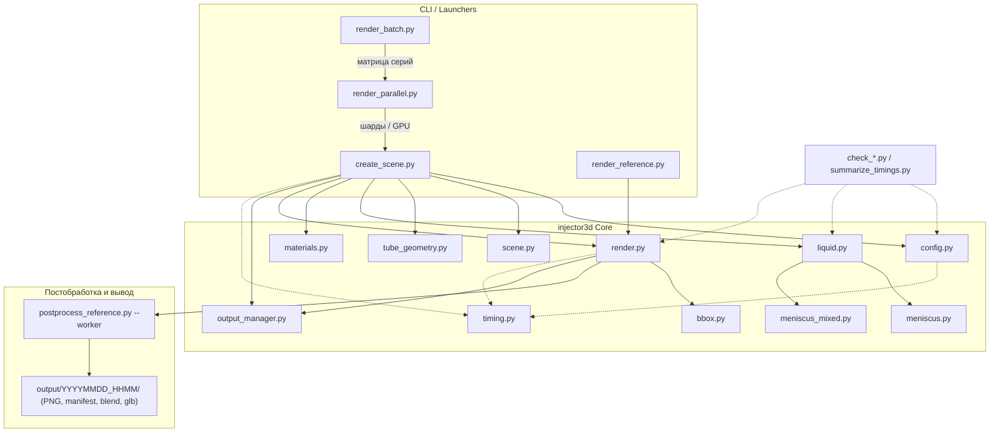

# injector3D

Headless-генератор фотореалистичных синтетических сцен в Blender/Cycles:
прозрачная цилиндрическая трубка с жидкостью, серия ракурсов для датасета
компьютерного зрения (уровень и мениск жидкости, 2D/3D-центр контактной
кромки, границы объекта).

## Что делает

Основной результат — серия `N+1` кадров:

- 1 вертикальный кадр;
- `N` наклонов на фиксированный угол `θ` в разных плоскостях азимута `φ`;
- обычно `N=4` или `N=8`, то есть 5 или 9 кадров;
- при `N=0` — только вертикальный кадр.

Геометрия по умолчанию: внутренний диаметр 19 мм, высота 92 мм, стенка
1 мм, закрытое дно, открытый верх, PMMA/акрил. Доля заполнения по
умолчанию `FILL_FRACTION = 0.5`; вместо неё можно задать объём
`--volume-mm3`. Значение `0` (`--volume-mm3 0` или `--fill-fraction 0`)
рендерит пустой цилиндр: меш жидкости и мениск не создаются, но кадры,
отражения и manifest формируются как обычно.

Отдельный сценарий `render_reference.py` повторяет референсный кадр
`06120.png` камерой OV5693 (объектив 1.3 мм, barrel-дисторсия, roll +1.5°).
Параметры камеры перенесены в основную серию.

## Требования

- Debian 13 (trixie);
- локальная сборка Blender 5.2.3 LTS в
  `./blender-5.2.3-linux-x64/blender` (папка в `.gitignore`);
- системный `python3` с PIL/numpy для постобработки и launcher-скриптов;
- окружение проверено 2026-11-08 на коммите `6d2f83f`: 2× Quadro P1000,
  CUDA 12.4, драйвер 550.163.01;
- при отсутствии CUDA используется CPU-fallback.

Не используйте системный `blender`: каноническая версия — локальная
сборка. Модули `injector3d/*`, импортирующие `bpy`, запускаются только
внутри Blender; проверки без `bpy` — системным `python3`.

## Быстрый старт

```bash
BL=./blender-5.2.3-linux-x64/blender
$BL --version

# Серия N+1: вертикаль + N азимутов наклона
$BL --background --python injector3d/create_scene.py -- \
    --mode ring --tilt-count 8 --tilt-angle 10

# Только вертикальный кадр (N=0)
$BL --background --python injector3d/create_scene.py -- --tilt-count 0

# То же через алиас режима
$BL --background --python injector3d/create_scene.py -- --mode upright

# Важно: --tilt-angle 0 не заменяет N=0; при N>0 угол должен быть
# строго в (0, 90).

# 5 фиксированных ракурсов
$BL --background --python injector3d/create_scene.py -- --mode tube

# Референсный кадр 06120
$BL --background --python render_reference.py

# Параллельный рендер серии по GPU (системный python3)
python3 render_parallel.py --tilt-count 8 --tilt-angle 10 --gpus 0,1

# Пакетная матрица параметров
python3 render_batch.py --liquids water,glycerol \
    --volumes 2000,5000 --tilt-angles 10,20 --gpus 0,1
```

Полный набор флагов — `reports/step6_cli.md`; имена файлов формирует
`injector3d/output_manager.py`.

### Жидкость и камера

```bash
$BL --background --python injector3d/create_scene.py -- \
    --liquid-type glycerol --camera-preset reference \
    --tilt-count 8 --tilt-angle 10
```

Доступны жидкости `water`, `glycerol`, `ethanol`, `mineral_oil` и
переопределения `--liquid-ior`, `--liquid-density`,
`--surface-tension`, `--contact-angle`, `--absorption-density`.
Камера: `--camera-preset reference|studio` и параметры дистанции, высоты,
цели, объектива, roll и дисторсии.

### Постобработка и bbox

Постобработка включена по умолчанию. `--no-postprocess` сохраняет PNG
сразу и не рисует overlay. Bbox считается по alpha-маске raw и
пересчитывается в final-координаты; он всегда попадает в manifest кадра.
Визуальный overlay bbox включается `--overlay-bbox` (синоним `--bbox`),
по умолчанию выключен. Overlay не должен попадать в alpha-bbox.

### Градуировка

Шкала объёма на внешней стенке трубки: короткие риски через 2 мл,
длинные на 0, 10 и 20 мл, подписи «10» и «20» повёрнуты на 180°.
Позиции рисок считаются из геометрии трубки (`h = V/(πR²)`), а не
снимаются с референса; нуль — внутренняя плоскость дна.

```bash
$BL --background --python injector3d/create_scene.py -- \
    --mode ring --tilt-count 4 --tilt-angle 10 --graduation
```

По умолчанию разметка выключена; `--no-graduation` отключает её явно.
Цвет, шрифт, кегль и размеры рисок задаются в
`config.SCENE_GRADUATION`. Подробности — `reports/step11_graduation.md`.

## Архитектура



Поток выполнения: `create_scene.py` собирает сцену, строит трубку и
жидкость, применяет материалы и вызывает `render.py`; `render.py`
рендерит raw PNG, считает bbox и отправляет кадр в
`postprocess_reference.py --worker`. `render_parallel.py` и
`render_batch.py` — внешние launcher-скрипты: они запускают несколько
процессов Blender и сливают manifest шардов/серий. Тайминги пишутся в
manifest и не зависят от `bpy`. Причины ключевых решений — `docs/adr/`.

## Выходные файлы

Один прогон — один каталог:

```text
<база>/<YYYYMMDD_HHMM>/
```

`<база>` — `--output-dir`, по умолчанию `config.OUTPUT_DIR` (`output/`).
`--timestamp` фиксирует имя каталога и синхронизирует шарды.

Имена:

```text
<жидкость>_<ракурс>[_<tag>][_v<объём>].png
<жидкость>_master[_<tag>][_s<k>of<M>].blend
<жидкость>_manifest[_<tag>][_s<k>of<M>].json
<жидкость>_shard<k>.log
<жидкость>[_<tag>].glb
```

Для ring-режима `tag` обычно содержит `a<угол>_n<N>`. Пакетный прогон:

```text
<output-dir>/<batch>/<series>/
<output-dir>/<batch>/batch_manifest.json
<output-dir>/<batch>/logs/
```

PNG в `output/` — результат работы и отслеживается git; `.blend`,
`.blend1`, `.json`, `.log`, `.glb` в `output/` игнорируются. Новые
прогоны делайте в новый каталог, не перезаписывайте старые. `output/06120/`
— отдельный результат под референс; `output/1/` … `output/4.5/` —
исторические прогоны старой схемы.

## Проверки

```bash
# Внутри Blender
$BL --background --python check_liquid.py
$BL --background --python check_liquid_presets.py
$BL --background --python check_meniscus_mixed.py

# Без Blender
python3 check_postprocess.py
python3 check_batch.py
python3 check_timing.py

# Сводка таймингов
python3 summarize_timings.py output/<прогон>/water_manifest.json
python3 summarize_timings.py output/<batch>/batch_manifest.json --by liquid_type

# Диагностика CUDA/GPU
$BL --background --python check_cuda.py
$BL --background --python check_build_cuda.py
$BL --background --python gpu_info.py
```

Тестового фреймворка, линтера и typecheck нет. Проверка — успешные
assert-прогоны и рендер без исключений.

## Документация

| Файл | Назначение |
|---|---|
| `AGENTS.md` | канонические правила для AI-агентов, команды и инварианты |
| `PLAN.md` | только текущие и будущие работы; выполненное удаляется |
| `CHANGELOG.md` | краткая история уже сделанных изменений |
| `reports/README.md` | индекс актуальных отчётов |
| `reports/` | подробные отчёты, замеры и обоснования |
| `reports/archive/` | исторические планы, аудиты и снимки |
| `docs/adr/` | ключевые архитектурные решения |
| `injector3d/config.py` | источник фактических параметров |

`reports/archive/plan_status_and_next_steps.md` — исторический аудит,
а не источник текущего статуса. Текущие работы — `PLAN.md`; история —
`CHANGELOG.md`.
