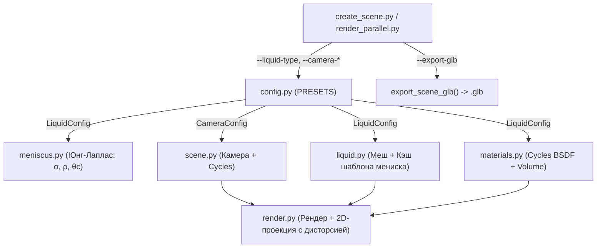

# План реализации: Завершение Пункта 6 (Пресеты жидкостей, экспорт GLB, управление камерой)

> **Исторический документ.** Пункт 6 выполнен; файл оставлен как архив
> решения. Актуальный план — `PLAN.md`, история — `CHANGELOG.md`,
> архитектура — `README.md#архитектура`.

## Описание задачи
Завершить оставшуюся функциональность Пункта 6 ([`reports/step6_cli.md`](file:///home/nikolay/opencv/injector3D/reports/step6_cli.md)):
1. **Пресеты жидкостей и физико-оптическая параметризация**:
   - Поддержка различных типов жидкостей через CLI (`--liquid-type [water|glycerol|ethanol|mineral_oil|custom]`).
   - Параметризация физических свойств (поверхностное натяжение $\sigma$, плотность $\rho$, краевой угол $\theta_c$, капиллярная длина $\lambda_c$) в солвере Юнга-Лапласа ([`meniscus.py`](file:///home/nikolay/opencv/injector3D/injector3d/meniscus.py)) и построении меша ([`liquid.py`](file:///home/nikolay/opencv/injector3D/injector3d/liquid.py)).
   - Параметризация оптических свойств (IOR, тон Base Color, цвет и плотность Volume Absorption) в шейдерах Cycles ([`materials.py`](file:///home/nikolay/opencv/injector3D/injector3d/materials.py)).
   - Сохранение параметров жидкости в метаданных кадра и JSON manifest.
2. **Экспорт 3D-сцены в GLB (glTF 2.0 Binary)**:
   - CLI-флаг `--export-glb [PATH]` для сохранения мешей трубки и жидкости с материалами (Principled BSDF).
3. **Параметризация камеры через CLI**:
   - Пресеты камеры (`--camera-preset [reference|studio]`).
   - Тонкая настройка ракурса через аргументы CLI (`--camera-distance`, `--camera-z`, `--camera-target-z`, `--camera-lens`, `--camera-roll`, `--camera-distortion`).
   - Автоматическая адаптация проекции 2D-центра эллипса под заданную дисторсию камеры.

---

## User Review Required

> [!IMPORTANT]
> **Обратная совместимость по умолчанию**:
> Все вызовы без новых аргументов (например, `$BL --background --python injector3d/create_scene.py -- 4.5`) сохранят текущее поведение по умолчанию: жидкость — `water`, камера — `reference` (06120), имена файлов не изменятся.
> При указании альтернативной жидкости (например, `--liquid-type glycerol`) имя файла получит тег `_liq-glycerol`, а в JSON manifest запишутся свойства жидкости.

> [!NOTE]
> **Экспорт GLB и объемное поглощение**:
> Формат GLTF 2.0 Binary полноценно поддерживает параметры Principled BSDF (Roughness, IOR, Transmission, Base Color). Нода Cycles `Volume Absorption` в стандартном GLB не отображается простыми вьюерами, поэтому цвет жидкости переносится в `Base Color` меша жидкости, обеспечивая корректное отображение в любых 3D/веб-вьюерах.

---

## Архитектура предлагаемых изменений



---

## Предлагаемые изменения по компонентам

### 1. Конфигурация и пресеты (`injector3d/config.py`)

#### [MODIFY] [`injector3d/config.py`](file:///home/nikolay/opencv/injector3D/injector3d/config.py)
- Добавить словарь `LIQUID_PRESETS`:
  - `water`: $\text{IOR}=1.333$, $\sigma=0.0728$ Н/м, $\rho=1000$ кг/м³, $\theta_c=25^\circ$, `base_color=(1.0, 1.0, 58/73, 1.0)`, `absorption_color=(1.0, 1.0, 0.42, 1.0)`, `absorption_density=20.0`.
  - `glycerol`: $\text{IOR}=1.473$, $\sigma=0.0634$ Н/м, $\rho=1261$ кг/м³, $\theta_c=45^\circ$, `base_color=(1.0, 1.0, 0.95, 1.0)`, `absorption_color=(1.0, 1.0, 0.85, 1.0)`, `absorption_density=8.0`.
  - `ethanol`: $\text{IOR}=1.361$, $\sigma=0.0223$ Н/м, $\rho=789$ кг/м³, $\theta_c=5^\circ$, `base_color=(1.0, 1.0, 1.0, 1.0)`, `absorption_color=(1.0, 1.0, 1.0, 1.0)`, `absorption_density=2.0`.
  - `mineral_oil`: $\text{IOR}=1.467$, $\sigma=0.0300$ Н/м, $\rho=850$ кг/м³, $\theta_c=35^\circ$, `base_color=(1.0, 0.95, 0.70, 1.0)`, `absorption_color=(1.0, 0.90, 0.35, 1.0)`, `absorption_density=35.0`.
- Добавить словарь `CAMERA_PRESETS`:
  - `reference`: OV5693 1.3 мм, дистанция 46 мм, target_z 35 мм, camera_z 40 мм, roll 1.5°, distortion 0.66, shift_x 105 px.
  - `studio`: 85 мм, сенсор 36×24 мм, дистанция 350 мм, target_z 46 мм, camera_z 46 мм, roll 0°, distortion 0.0, shift_x 0 px.
- Функции получения конфигурации:
  - `get_liquid_config(preset='water', **overrides)`
  - `get_camera_config(preset='reference', **overrides)`

---

### 2. Физический солвер мениска (`injector3d/meniscus.py`)

#### [MODIFY] [`injector3d/meniscus.py`](file:///home/nikolay/opencv/injector3D/injector3d/meniscus.py)
- Преобразовать модуль так, чтобы формулы не опирались исключительно на глобальные константы модуля:
  ```python
  def solve_meniscus(R_mm, surface_tension=None, liquid_density=None,
                     contact_angle_deg=None, steps=None):
      st = SURFACE_TENSION if surface_tension is None else float(surface_tension)
      rho = LIQUID_DENSITY if liquid_density is None else float(liquid_density)
      theta_deg = CONTACT_ANGLE_DEG if contact_angle_deg is None else float(contact_angle_deg)
      n_steps = MENISCUS_STEPS if steps is None else int(steps)

      cap_lambda_mm = math.sqrt(st / (rho * GRAVITY)) * 1000.0
      theta = math.radians(theta_deg)
      ctg = math.cos(theta) / math.sin(theta)
      cos_val = math.cos(theta)
      analytic_dV = 2 * math.pi * cap_lambda_mm**2 * R_mm * cos_val
      ...
  ```
- Возвращать в словаре решения вычисленные свойства (`cap_lambda_mm`, `contact_angle_deg`, `analytic_delta_V_mm3`).

---

### 3. Материалы (`injector3d/materials.py`)

#### [MODIFY] [`injector3d/materials.py`](file:///home/nikolay/opencv/injector3D/injector3d/materials.py)
- Обновить `create_material_liquid(name="Liquid", liquid_config=None)`:
  - Принимать объект/словарь `liquid_config`.
  - Задавать `bsdf.inputs["IOR"].default_value = cfg['ior']`.
  - Задавать `bsdf.inputs["Base Color"].default_value = cfg['base_color']`.
  - Задавать `vol.inputs["Color"].default_value = cfg['absorption_color']`.
  - Задавать `vol.inputs["Density"].default_value = cfg['absorption_density']`.

---

### 4. Геометрия и кэширование жидкости (`injector3d/liquid.py`)

#### [MODIFY] [`injector3d/liquid.py`](file:///home/nikolay/opencv/injector3D/injector3d/liquid.py)
- Добавить передачу `liquid_props` (кортеж `(surface_tension, liquid_density, contact_angle_deg)`) во все функции вычисления мениска:
  - `_meniscus_profile(R_mm, liquid_props=None)`:
    - Ключ кэша: `(round(R_mm, 9), props_tuple)`.
  - `meniscus_wall_rise_mm(liquid_props=None)`
  - `meniscus_volume_mm3(liquid_props=None)`
  - `meniscus_template_cached(cos_theta, r_eq_mm, segments, liquid_props=None)`:
    - Ключ кэша: `(round(cos_theta, 6), round(r_eq_mm, 6), props_tuple)`.
  - `build_liquid(obj, tube, target_mm3, segments=..., use_fast=True, liquid_config=None)`:
    - Извлекать `liquid_props` из `liquid_config`.
    - Сохранять `liquid_type` и `liquid_config` в возвращаемом словаре `info`.
  - `contact_level_mm(mw, level_mm, flat=False, liquid_props=None)`
  - `contact_center_mm(mw, level_mm, flat=False, liquid_props=None)`

---

### 5. Настройка сцены и камеры (`injector3d/scene.py`)

#### [MODIFY] [`injector3d/scene.py`](file:///home/nikolay/opencv/injector3D/injector3d/scene.py)
- Сигнатура `setup_scene(gpu_index=None, camera_config=None)`:
  - Использовать `camera_config` вместо жесткого `SCENE_CAMERA`.
  - Задавать `cam.data.lens`, `sensor_width`, `sensor_height`, `fstop`, `focus_distance`, позицию и наведение по переданному конфигу.
  - Сохранять конфигурацию камеры в объекте камеры (`cam['config'] = camera_config`) для последующего использования в `render.py`.

---

### 6. Рендер и экспорт (`injector3d/render.py`)

#### [MODIFY] [`injector3d/render.py`](file:///home/nikolay/opencv/injector3D/injector3d/render.py)
- Экспорт GLB:
  ```python
  def export_scene_glb(filepath, objects=None):
      """Экспорт выбранных объектов в GLB."""
      ...
  ```
- Именование файлов:
  - Если `liquid_type != 'water'`, добавлять тег `_liq-<type>` в имя PNG кадра.
- Адаптивная дисторсия в 2D-проекции:
  - В `_project_center_raw` и `_prepare_render_scene` использовать параметр `distortion` из активной конфигурации камеры сцены (`cam['config']['distortion']` или fallback на `SCENE_CAMERA['distortion']`).
  - При `distortion == 0` пропускать ноду `Lensdist` в композиторе и отдавать неискажённую линейную проекцию.
- В метаданные кадра и manifest серии добавлять поля:
  - `liquid_type`, `liquid_ior`, `camera_preset`.

---

### 7. CLI и точка входа (`injector3d/create_scene.py`)

#### [MODIFY] [`injector3d/create_scene.py`](file:///home/nikolay/opencv/injector3D/injector3d/create_scene.py)
- Добавить разбор новых CLI-аргументов:
  - Жидкость:
    - `--liquid-type [water|glycerol|ethanol|mineral_oil]`
    - `--liquid-ior <float>`
    - `--liquid-density <float>`
    - `--surface-tension <float>`
    - `--contact-angle <float>`
    - `--absorption-density <float>`
  - Камера:
    - `--camera-preset [reference|studio]`
    - `--camera-distance <float>`
    - `--camera-z <float>`
    - `--camera-target-z <float>`
    - `--camera-lens <float>`
    - `--camera-roll <float>`
    - `--camera-distortion <float>`
  - Экспорт:
    - `--export-glb [PATH]`
  - Оверлей:
    - `--overlay-liquid / --no-overlay-liquid`
- Формирование `liquid_config` и `camera_config` через вызовы helper-функций из `config.py`.
- Вызов `export_scene_glb` при наличии флага `--export-glb`.

---

## План верификации

### Автоматические тесты
1. **Регрессионная проверка базовой физики**:
   ```bash
   ./blender-5.2.3-linux-x64/blender --background --python check_liquid.py
   ```
   *Ожидается:* 8/8 секций проходят успешно, расхождения объёмов и кромки $\le$ допустимых порогов.
2. **Проверка постобработки**:
   ```bash
   python3 check_postprocess.py
   ```
   *Ожидается:* Все проверки постобработки пройдены.
3. **Проверка новых жидкостей**:
   - Написать проверочный сценарий или расширить `check_liquid.py`:
     - Проверка сходимости Юнга-Лапласа и инвариантности объёма $V(\theta) = \text{const}$ для `glycerol`, `ethanol`, `mineral_oil`.
4. **Тест GLB-экспорта**:
   ```bash
   ./blender-5.2.3-linux-x64/blender --background --python injector3d/create_scene.py -- 4.5 \
       --tilt-count 1 --tilt-angle 10 --export-glb output/test_scene.glb
   ```
   *Ожидается:* Файл `output/test_scene.glb` создан, размер $> 0$, содержит меши трубки и жидкости.
5. **Тест альтернативной камеры и жидкости**:
   ```bash
   ./blender-5.2.3-linux-x64/blender --background --python injector3d/create_scene.py -- 4.5 \
       --liquid-type glycerol --camera-preset studio --tilt-count 2 --tilt-angle 15
   ```
   *Ожидается:* Кадры с тегом `_liq-glycerol_`, studio-ракурс без дисторсии, manifest содержит свойства глицерина.

### Ручная проверка
- Визуальная оценка сгенерированных кадров (различие оптических эффектов глицерина и этанола по сравнению с водой).
- Открытие экспортированного `.glb` файла в 3D-вьюере для проверки целостности мешей и материалов.
