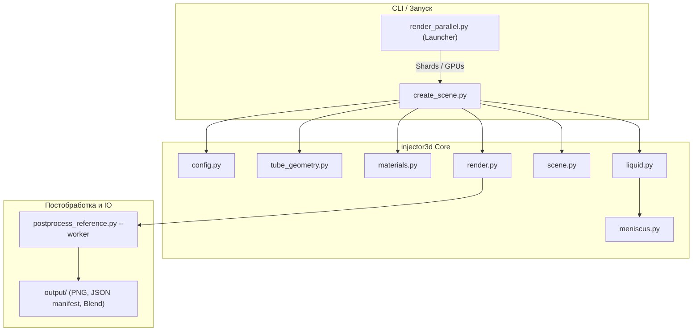

# Анализ проекта injector3D: текущий статус и план дальнейших действий

## Цель проекта и контекст

Проект **injector3D** представляет собой headless-генератор синтетических фотореалистичных 3D-сцен в Blender (Cycles) для рендеринга цилиндрической прозрачной пробирки (трубки ⌀19×92 мм) с жидкостью под заданным набором углов наклона ($N+1$: вертикаль + $N$ азимутальных плоскостей наклона).

Сгенерированные изображения служат синтетическим обучающим датасетом для компьютерного зрения (определение уровня и мениска жидкости, оценка 2D/3D координат центра эллипса контакта, границ раздела фаз).

> **Обновление 2026-11-08:** batch runner реализован (`render_batch.py`,
> `check_batch.py`), пункт 6 закрыт. Пункт 10 (смешанный мениск) также
> завершён и интегрирован в `build_liquid()`.

---

## Текущее состояние этапов (Аудит)

| Этап | Описание | Статус | Артефакты / Документы |
|---|---|---|---|
| **1. Геометрия трубки** | Manifold-меш вращения 192 сегмента, скругления дна и верхнего буртика | ✅ **Завершён** | [`injector3d/tube_geometry.py`](file:///home/nikolay/opencv/injector3D/injector3d/tube_geometry.py), [`reports/step1.md`](file:///home/nikolay/opencv/injector3D/reports/step1.md) |
| **2. Объём жидкости** | Мировой горизонт, бисекция уровня по целевому объёму, проверка перелива | ✅ **Завершён** | [`injector3d/liquid.py`](file:///home/nikolay/opencv/injector3D/injector3d/liquid.py), [`reports/step2.md`](file:///home/nikolay/opencv/injector3D/reports/step2.md) |
| **3. Физический мениск** | ОДУ Юнга-Лапласа (РК4), радиальная сетка крышки, эллиптическая кромка под наклоном | ✅ **Завершён** | [`injector3d/meniscus.py`](file:///home/nikolay/opencv/injector3D/injector3d/meniscus.py), [`reports/step3.md`](file:///home/nikolay/opencv/injector3D/reports/step3.md) |
| **4. Материалы** | Оптика PMMA (акрил, IOR 1.49), Principled BSDF + объёмное поглощение жидкости (подбор поглощения под B/R) | ✅ **Завершён** | [`injector3d/materials.py`](file:///home/nikolay/opencv/injector3D/injector3d/materials.py), [`reports/step4.md`](file:///home/nikolay/opencv/injector3D/reports/step4.md) |
| **4.5. Серия $N+1$ и оптимизация** | Серия наклонов вокруг середины трубки ($R_z(\phi) R_y(\theta) R_z(-\phi)$), привязка камеры к трубке, шаблон мениска с $\Delta V_{under}$, 2 постройки меша на серию | ✅ **Завершён** | [`reports/step4.5.md`](file:///home/nikolay/opencv/injector3D/reports/step4.5.md), [`reports/performance.md`](file:///home/nikolay/opencv/injector3D/reports/performance.md) |
| **Референс 06120** | Камера OV5693 1.3 мм, barrel-дисторсия 0.66, roll +1.5°, центрирование 105 px | ✅ **Завершён** | [`render_reference.py`](file:///home/nikolay/opencv/injector3D/render_reference.py), [`reports/reference_camera_06120.md`](file:///home/nikolay/opencv/injector3D/reports/reference_camera_06120.md) |
| **5. Постобработка и оверлеи** | Фоновый worker (`postprocess_reference.py`), Lensdist-проекция 2D центра эллипса, маркер, текстовые оверлеи, manifest серии | ✅ **Завершён (основное)** | [`check_postprocess.py`](file:///home/nikolay/opencv/injector3D/check_postprocess.py), [`reports/step5_postprocessing.md`](file:///home/nikolay/opencv/injector3D/reports/step5_postprocessing.md) |
| **6. CLI и параллелизация** | `--volume-mm3`, `--fill-fraction`, `--gpu-index`, шардирование, multi-process launcher [`render_parallel.py`](file:///home/nikolay/opencv/injector3D/render_parallel.py), пакетный [`render_batch.py`](file:///home/nikolay/opencv/injector3D/render_batch.py), fallback малого объёма | ✅ **Завершён** | [`reports/step6_cli.md`](file:///home/nikolay/opencv/injector3D/reports/step6_cli.md), [`check_batch.py`](file:///home/nikolay/opencv/injector3D/check_batch.py) |
| **7. Калибровка и тесты рендера** | Оценка освещения под разными углами, каустики, калибровка мира | ⏳ **В очереди** | [`calib_world.py`](file:///home/nikolay/opencv/injector3D/calib_world.py) |
| **8. Капли на стенках** | 0–2 капли на внутренней поверхности трубки, детерминированные seed | ⏳ **Не начат** | Конфиг заготовлен в [`injector3d/config.py`](file:///home/nikolay/opencv/injector3D/injector3d/config.py#L59-L67) |
| **9. Пузырьки у мениска** | 0–N пузырьков воздуха в объёме жидкости | ⏳ **Не начат** | В плане |
| **10. Солвер смешанного контакта** | Мениск на стыке стенки и дна/галтели при малых объёмах и больших углах | ✅ **Реализован и интегрирован** | [`reports/meniscus_mixed_prototype.md`](file:///home/nikolay/opencv/injector3D/reports/meniscus_mixed_prototype.md), [`reports/meniscus_mixed_contact.md`](file:///home/nikolay/opencv/injector3D/reports/meniscus_mixed_contact.md) |

### Проверка работоспособности кода
- `./blender-5.2.3-linux-x64/blender --background --python check_liquid.py` — **ВСЕ ПРОВЕРКИ ПРОЙДЕНЫ** (8 секций, инвариантность объёма, мениск, fast-path, $R_z(\phi)$-инвариантность, граничные объёмы).
- `python3 check_postprocess.py` — **ВСЕ ПРОВЕРКИ ПРОЙДЕНЫ** (alpha bbox, пересчёт 2D центра, сдвиги, маркер, worker result).
- `python3 check_batch.py` — **ВСЕ ПРОВЕРКИ ПРОЙДЕНЫ** (матрица, команды, resume, `batch_manifest.json`, dry-run).

---

## На чём конкретно остановились

Последняя сессия завершилась на коммите `34179bd` (*«Пункт 6: fallback малого объёма и план солвера смешанного контакта»*):

1. **Решена проблема падения на малых объёмах (краевой случай)**:
   При малых объёмах ($\le 2000$ мм³) и наклонах $\ge 30^\circ$ плоскость контакта жидкости касается дна/скругления пробирки. Стандартная радиальная шапка мениска требует замкнутой эллиптической линии контакта целиком на стенке цилиндра. Из-за этого возникал разрыв объёма ($\approx 300$ мм³) между плоским телом и полным мениском, и бисекция падала.
   В [`injector3d/liquid.py`](file:///home/nikolay/opencv/injector3D/liquid.py) был внедрён детектор разрыва и плоский fallback (`flat=True`), гарантирующий точный объём и валидность геометрии, а математическая постановка полноценного решения вынесена в отдельный пункт 10 ([`reports/meniscus_mixed_contact.md`](file:///home/nikolay/opencv/injector3D/reports/meniscus_mixed_contact.md)).

2. **Остаток Пункта 6 (CLI-обвязка)**:
   В [`reports/step6_cli.md`](file:///home/nikolay/opencv/injector3D/reports/step6_cli.md) зафиксированы 4 незавершённые фичи пункта 6:
   - **Выбор типа жидкости**: параметры жидкости (IOR, цвет и плотность поглощения, поверхностное натяжение $\sigma$, плотность $\rho$, краевой угол $\theta_c$) жёстко зашиты в коде для воды.
   - **Параметризация камеры**: текущая камера зафиксирована под референс 06120; нет возможности управлять ракурсом камеры через аргументы CLI.
   - **Пакетная генерация датасета (Batch runner)**: сейчас `render_parallel.py` умеет параллелить только одну серию углов для одного набора параметров; нет пакетного запуска матрицы параметров (объёмы $\times$ углы $\times$ жидкости).
   - **Экспорт сцены в `.glb`**: сохраняются только `.blend` и `.png`.

3. **Неотслеживаемые тестовые файлы**:
   В `output/4.5/` и `output/1/` после отладки малых объёмов остались локальные тестовые рендеры (серии $v500, v1000, v2000$).

---

## Архитектура системы



---

## План дальнейших действий (Roadmap)

Рекомендуется двигаться по этапам в порядке возрастания сложности:

### Этап 6.2. Завершение пункта 6 (CLI, типы жидкостей, экспорт GLB) — ✅

#### 1. Пресеты и параметры жидкостей — ✅
- Добавить в [`injector3d/config.py`](file:///home/nikolay/opencv/injector3D/injector3d/config.py) реестр жидкостей `LIQUID_PRESETS`:
  - `water` (вода, текущие параметры): $\text{IOR}=1.33$, $\sigma=0.0728$, $\rho=1000$, $\theta_c=25^\circ$, слабо-жёлтый тинт, плотность 20.0.
  - `glycerol` (глицерин): $\text{IOR}=1.47$, $\sigma=0.063$, $\rho=1260$, $\theta_c\approx 45^\circ$, прозрачный / нейтральный.
  - `ethanol` (этанол): $\text{IOR}=1.36$, $\sigma=0.022$, $\rho=789$, $\theta_c\approx 0^\circ$ (высокое смачивание).
  - `mineral_oil` (масло): $\text{IOR}=1.46$, $\sigma=0.030$, $\rho=850$, $\theta_c\approx 35^\circ$, желтоватый/янтарный оттенок.
  - `custom`: пользовательские параметры через флаги.
- Параметризовать [`injector3d/meniscus.py`](file:///home/nikolay/opencv/injector3D/injector3d/meniscus.py) и [`injector3d/materials.py`](file:///home/nikolay/opencv/injector3D/injector3d/materials.py), убрав глобальные константы поверхностного натяжения/IOR при вычислении.
- Добавить аргументы CLI в [`injector3d/create_scene.py`](file:///home/nikolay/opencv/injector3D/injector3d/create_scene.py):
  `--liquid-type [water|glycerol|ethanol|mineral_oil]` и кастомные переопределения (`--liquid-ior`, `--liquid-density`, `--contact-angle`).
- Добавить имя типа жидкости в имя PNG и manifest серии (`4.5_..._liq-water_...png`).

#### 2. Экспорт в `.glb` — ✅
- Добавить CLI-флаг `--export-glb [PATH]`.
- Экспортировать сцену (меш трубки, меш жидкости с PBR-нодами) в формат GLTF 2.0 Binary (`bpy.ops.export_scene.gltf(...)`) с сохранением названий объектов и базовых материалов.

#### 3. Управление камерой через CLI — ✅
- Поддержать выбор режима камеры:
  - `--camera-preset [reference|studio|orbit]`
  - Возможность задания параметров камеры: дистанция (`--camera-distance`), высота (`--camera-z`), угол pitch/roll.

#### 4. Пакетный генератор датасетов (`render_batch.py`) — ✅
- Реализован: JSON-конфиг или диапазоны CLI, матрица
  `объём/доля × угол × жидкость × камера`.
- Каждая серия идёт в `<output-dir>/<batch>/<series>/` через
  `render_parallel.py`; в корне пакета — `batch_manifest.json` и `logs/`.
- Поддержаны `--limit`, `--resume`, `--keep-going`, `--keep-shards`,
  `--dry-run`; проверки — `check_batch.py`.

---

### Этап 8 & 9. Капли на стенках и пузырьки воздуха (Визуальный реализм)

#### 1. Пункт 8: Капли на внутренней поверхности трубки
- Генератор 0–2 капель внутри трубки выше уровня жидкости (параметры уже намечены в `DROPLETS_*` в [`injector3d/config.py`](file:///home/nikolay/opencv/injector3D/injector3d/config.py#L62-L66)).
- Меш: сферические шапочки (сферический сегмент) с краевым углом капли на PMMA.
- Привязка капель к системе координат трубки (капли наклоняются вместе с трубкой).
- Проверка, чтобы капли не пересекали текущий наклонный уровень жидкости.
- Материал: тот же материал жидкости.

#### 2. Пункт 9: Пузырьки воздуха в жидкости
- 0–$N$ пузырьков воздуха под поверхностью мениска (случайное распределение по seed).
- Моделирование в Cycles: сфера с нормалями, направленными внутрь (или материал «Air in Liquid» с относительным IOR $1 / \text{IOR}_{liq}$).

---

### Этап 10. Солвер смешанного контакта (Углублённая гидродинамика) — ✅
- Задача: построение мениска для случаев, когда уровень жидкости опускается настолько низко, что свободная поверхность пересекает галтель и дно пробирки.
- Реализован clipped-солвер: осесимметричный профиль обрезается дном,
  смешанная линия контакта получается геометрически; меш замкнутый.
- `build_liquid()` автоматически выбирает mixed-режим; 2000 мм³ при
  50°/60° строятся без `flat=True`.
- 2D-PDE оставлен экспериментальным; точная 3D-форма у сухой части
  контактной линии — возможное развитие.

---

## План верификации

### Автоматические тесты
```bash
# 1. Проверка мениска, объёмов, инвариантов геометрии
./blender-5.2.3-linux-x64/blender --background --python check_liquid.py

# 2. Проверка постобработки, оверлеев и 2D-координат
python3 check_postprocess.py

# 3. Проверка batch runner без Blender
python3 check_batch.py

# 4. Тест новых CLI-аргументов (liquid presets)
./blender-5.2.3-linux-x64/blender --background --python injector3d/create_scene.py -- --mode ring --liquid-type glycerol --tilt-count 1 --tilt-angle 10
```

### Ручная проверка
- Визуальная инспекция сгенерированных PNG в `output/` при смене типов жидкостей и параметров оверлея.
- Проверка структуры выходного JSON manifest.
